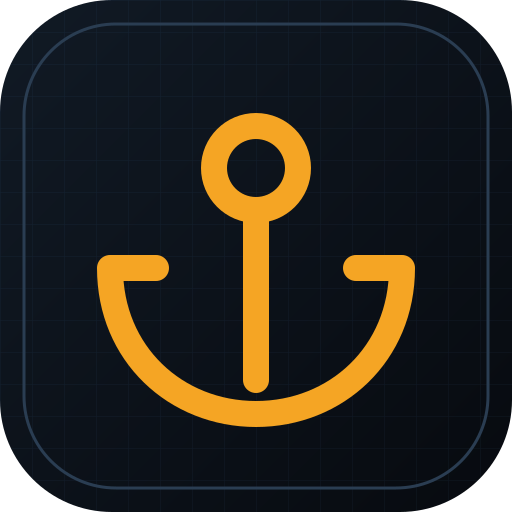
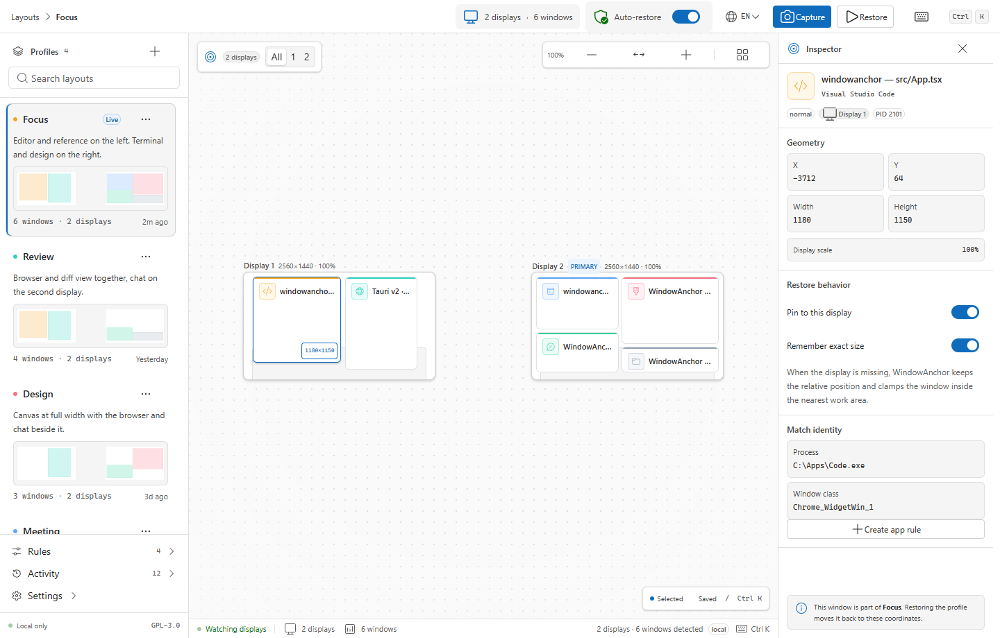

<p align="center">
  
</p>

<h1 align="center">WindowAnchor</h1>

<p align="center">
  <strong>Window layouts that stay put.</strong><br />
  Remember and restore app window positions across displays, resolutions, and DPI scales.
</p>

<p align="center">
  
  
  
</p>



WindowAnchor is an open-source desktop layout manager. It captures the windows you
care about, stores their geometry per display configuration, and puts them back
when your monitors change. The interface is a Fluent layout editor: displays are
drawn to scale, windows are selectable, and every restore explains what matched,
what was skipped, and why.

> **Status: early preview.** The repository currently ships the Tauri + React
> shell, the Windows window inventory, manual capture, and a best-effort restore.
> Automatic triggers, persistent profile storage, and macOS support are the next
> milestones. See the roadmap below.

## Why another window manager?

Most tools solve one of three problems:

- **Snapping and zones**: FancyZones, AquaSnap, Rectangle.
- **Automatic layout restore after monitor changes**: PersistentWindows.
- **Named layout snapshots**: PowerToys Workspaces, DisplayFusion.

WindowAnchor aims to combine all three in one local-first product with a visual
editor: per-app rules, monitor-configuration-aware profiles, automatic restore,
and a clear restore report. It is built for people who dock and undock, switch
between home and office desks, and use mixed resolutions or scales.

## Features

### Available in this scaffold

- **Fluent layout editor** with per-display focus, zoom, and a live window inventory.
- **Per-layout actions**: use the `…` menu on a layout card to delete it.
- **Capture dialog** with window selection, display summary, and layout naming.
- **Windows window enumeration** through Win32 (`EnumWindows`, `GetWindowPlacement`,
  DWM frame bounds, monitor identity).
- **Best-effort restore** with process path, window class, and title matching.
- **Fluent UI React v9** controls, light/dark/system themes, and a FancyZones-style
  layout editor.
- **App rules, activity, settings, and command palette** surfaces for the product
  model that follows.
- **Four interface languages**: English, 한국어, 简体中文, 日本語, with system-language
  detection and a per-user preference.
- **Local-first storage** for profiles in the current build (WebView local storage).
- **Keyboard-first**: `Ctrl K` command palette, `Ctrl Shift C` capture.

### Planned

- Persistent profile and rule storage in the app data directory.
- Automatic restore on display change, resolution change, wake, and dock.
- Monitor configuration profiles keyed by device ID, resolution, and scale.
- macOS support through the Accessibility API (`AXUIElement`).
- Tray menu, launch at login, import/export, and restore diagnostics.
- Signed Windows installer and notarized macOS DMG.

## Platform support

| Platform | Status | Window API | Notes |
|---|---|---|---|
| Windows 10/11 | Early preview | Win32 + DWM | Primary development target. Mixed-DPI behavior is tested manually. |
| macOS 13+ | Planned | Accessibility API (`AXUIElement`) | Requires the user to grant Accessibility permission. Direct distribution only. |
| Linux | Not planned | — | Out of scope for the first product. |

## Development

### Prerequisites

- **Node.js** 22 or newer
- **Rust** stable with the MSVC toolchain
- **Microsoft C++ Build Tools** with the "Desktop development with C++" workload
- **Microsoft Edge WebView2** (preinstalled on Windows 10 1803+ and Windows 11)

Tauri's official prerequisites are at
<https://tauri.app/start/prerequisites/>.

### Run the app

```powershell
npm install
npm run tauri dev
```

The frontend alone runs in a browser with realistic mock data:

```powershell
npm run dev
```

This is useful for UI work. The browser build never calls Win32; the live desktop
inventory appears only in the Tauri shell.

### Checks

```powershell
npm run check        # TypeScript
npm run build        # Production frontend build
npm run qa:i18n      # Language route and missing-key QA (dev server running)
npm run qa:ui        # UI screenshots (dev server running)
cargo fmt --manifest-path src-tauri/Cargo.toml --check
cargo clippy --manifest-path src-tauri/Cargo.toml -- -D warnings
cargo test --manifest-path src-tauri/Cargo.toml
```

## Project structure

```text
src/                     React UI
  Root.tsx               FluentProvider, light/dark/system theme
  components/            Shell, canvas, inspector, dialogs, views
  i18n/                  English, Korean, Simplified Chinese, Japanese
  lib/                   Types, mock data, Tauri bridge
  hooks/                 Resize observer
src-tauri/               Rust backend
  src/model.rs           Display, window, restore DTOs
  src/platform/          Platform implementations
    windows.rs           Win32 enumeration and restore
  src/lib.rs             Tauri commands
docs/                    Architecture and screenshots
scripts/                 UI QA and screenshot helpers
```

## How restore works

1. Enumerate visible top-level windows and read their window rect, DWM visual
   rect, state, process path, class, and monitor.
2. Store the target geometry with the display's stable identity and scale.
3. On restore, prefer the original window handle when its process and class still
   match. Fall back to process path, class, and title only when the window was
   recreated. If several windows match equally, skip the target rather than move
   the wrong window.
4. Move the matched window with `SetWindowPos`, restore minimized windows first,
   and reapply maximized state last. Restore the captured relative stacking order.
5. Report `restored`, `skipped`, and `failed` counts with a reason. A missing
   window never blocks the rest of the layout.

Only windows stored in the active layout are moved. Other visible windows stay
where they are; the Inspector shows how many windows are currently open versus how
many are part of the layout.

The current implementation matches windows in the live session and across app
restarts when the process is still running. Persistent profile storage and a
full monitor-configuration matcher are the next milestone.

## Design direction

WindowAnchor uses **Fluent UI React v9**, Microsoft's Windows 11 design system, so
it feels at home next to PowerToys and Windows Settings rather than like a web
dashboard.

- Segoe UI Variable typography, Fluent color tokens, rounded cards, and standard
  Windows controls.
- Light theme by default, with dark theme and system-theme following.
- A FancyZones-style layout editor: neutral monitor frames, a subtle grid, and
  window cards with app accents.
- Fluent dialogs, menus, switches, badges, and command surfaces. The canvas is the
  only large custom surface.
- The UI is keyboard-operable and reduced-motion aware. Accessibility and contrast
  checks are part of the QA pass.

The PowerToys FancyZones editor is the main visual reference. The product does not
copy PowerToys code or assets.

## Internationalization

The interface ships with English, Korean, Simplified Chinese, and Japanese.
Translations live in `src/i18n/index.ts`; the app detects the system language on
first launch and stores the user's choice in `windowanchor.language`. The language
menu is in the top bar and in Settings.

- UI copy must go through `t()`; do not add hardcoded visible strings.
- Sample profiles, sample activity, and sample rule targets use translation keys
  so they change language immediately.
- Window titles, process paths, and app names stay in their original language.
- Add a language by extending the `resources` object and the `LANGUAGES` list in
  `src/components/LanguageMenu.tsx`.

## Roadmap

| Milestone | Scope |
|---|---|
| M0 · Scaffold | Tauri + React shell, design system, CI, docs |
| M1 · Windows inventory | Displays, windows, capture dialog, manual restore |
| M2 · Persistence | Profiles, rules, monitor configurations in app data |
| M3 · Automation | Display-change and wake triggers, debounce, restore report |
| M4 · macOS | Accessibility bridge, permissions onboarding, DMG packaging |
| M5 · Product polish | Tray, login item, updater, signed installers, import/export |

## Contributing

Contributions are welcome. Read [CONTRIBUTING.md](CONTRIBUTING.md) before opening a
pull request. UI changes should include a screenshot or a short recording, and
platform changes should state which display configuration was tested.

## License

WindowAnchor is licensed under the **GNU General Public License v3.0 or later**
(`GPL-3.0-or-later`). See [LICENSE](LICENSE).

Copyright (C) 2026 m16khb

This program is free software: you can redistribute it and/or modify
it under the terms of the GNU General Public License as published by
the Free Software Foundation, either version 3 of the License, or
(at your option) any later version.

This program is distributed in the hope that it will be useful,
but WITHOUT ANY WARRANTY; without even the implied warranty of
MERCHANTABILITY or FITNESS FOR A PARTICULAR PURPOSE.  See the
GNU General Public License for more details.

You should have received a copy of the GNU General Public License
along with this program.  If not, see <https://www.gnu.org/licenses/>.
